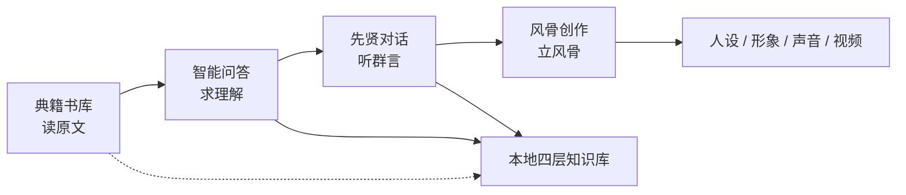
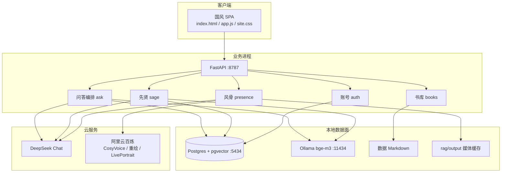

# Analects Realm

## Overview

**一站式《论语》沉浸式学习与创作平台**

> 读典籍 · 问疑惑 · 听群言 · 立风骨  
> 让用户从「被动读论语」走向「与先贤对话、以国学修身、自定义国风创作」。

---

## Contents

1. [项目概述](#1-项目概述)
2. [项目灵感来源](#2-项目灵感来源)
3. [项目定位](#3-项目定位)
4. [用户旅程与产品结构](#4-用户旅程与产品结构)
5. [功能演示与详细介绍](#5-功能演示与详细介绍)
6. [完整技术路线](#6-完整技术路线)
7. [模型与服务选用](#7-模型与服务选用)
8. [知识资产与内容分层](#8-知识资产与内容分层)
9. [设计原则与内容伦理](#9-设计原则与内容伦理)
10. [部署与运行说明](#10-部署与运行说明)
11. [当前局限与可演进方向](#11-当前局限与可演进方向)
12. [演示建议路径](#12-演示建议路径)
13. [结语](#13-结语)

---

## 1. Overview

**智启论语**（全称「孔子之境 · 智启论语」）是一套面向国学学习、文化科普与个性化表达的本地可运行 Web 系统。它不以「再做一个问答机器人」为目标，而是把《论语》相关的**阅读、求解、对话、修身、创作**收束为同一条体验：

| 能力 | 用户得到什么 |
| --- | --- |
| 典藏书库 | 竖排卷轴式阅读原典、注疏、礼书与史传 |
| 智能问答 | 治学、修心、修身三种用法，答案带检索出处 |
| 先贤对话 | 孔子及十六位孔门弟子的围坐群聊与一对一私聊 |
| 风骨创作 | 五德人设、古风形象、专属音色与诵读短视频 |
| 个人中心 | 账号登录、本地研习痕迹与收藏 |

系统由三部分组成：浏览器端国风 SPA、Python/FastAPI 业务服务、Docker 中的 Postgres（pgvector）与 Ollama 嵌入服务。对话生成走 DeepSeek，风骨多模态走阿里云百炼。典籍正文始终在本地，检索与引用可核对，避免把网络名言误称为孔子原话。

---

## 2. Origin

本项目灵感源自济南举办的 **9.28 米巨型 AI 机器人孔子互动叙事作品《子曰》** 发布活动。该作品打破了传统国学静态展示、书本诵读的固有模式，依托人工智能重塑先贤 IP，以沉浸式人机互动、智能叙事对话，让千年儒家文化走出古籍书卷、进入数字化交互现场。它证明了一条清晰的路径：

**传统文化 + AI 智能交互 + 沉浸式叙事**，可以成为新时代国学传播与传统文化活化的优质方案。

《子曰》给我们的启发，不只是「让孔子开口说话」，而是三层更具体的判断：

1. **先贤可以成为可交互的文化 IP**，而不是博物馆里的静止塑像。
2. **沉浸感来自场景与对话**，而不是把古文再排一次版。
3. **技术必须服务传承**：互动若没有典籍依据，就会变成娱乐化戏说。

在此基础上，我们对照当下国学学习的现实痛点：形式偏单一、典籍研读门槛高、数字化产品多为静态图文或同质化聊天机器人。本项目不再停留于传统《论语》读物、网课、文字解析，而是借鉴《子曰》「AI 先贤互动」的核心创意，进一步做 **场景化、个性化、可日常使用**：

- 把巨型装置上的一次性叙事，落成可持续打开的学习平台；
- 把「与孔子对话」扩展为「与孔门同席」——颜回、子路、子贡等性情各异的同门都会发言；
- 把「看一场互动」延伸为「自己也能立人设、发声、成片」。

项目旨在以 AI 为桥梁，让用户完成角色转换：从被动阅读，到与先贤对话、以国学修身、自定义国风创作。它同时适配青少年研学、国学爱好者自修、校园课程展示与传统文化科普等多元场景。

---

## 3. Positioning

### 3.1 The problem

我们把问题拆成学习者、传播者和内容本身三侧。

**学习者侧**

- 原文难入门：字词、章句、人物、篇次分散，查一句往往要翻多本书。
- 读完用不上：情绪困扰、人际冲突、学习习惯很难与具体章句建立可靠对应。
- 角色感缺失：知道「孔子说了仁」，却听不到孔门内部不同性格如何争论同一件事。

**传播侧**

- 静态展示难以产生停留：展板、电子书、短视频剪辑难以形成「再来一次」的互动。
- 戏说与考据两极：要么完全娱乐、出处混乱，要么一味训诂、拒人于门外。

**内容侧**

- 大模型容易编造「孔子语录」、把注疏说成原文、用「汝当」「善哉」扮演古人训诫用户。
- 缺少分层知识库：原文、注疏、礼、史传被混称为「论语里写过」。

本项目的回答是：**用可核对的检索约束生成，用三种问答模式区分「读懂 / 看待自己 / 如何去做」，用孔门群像而不是单一孔子人设提供对话，再用五德创作把学习收束为属于用户自己的作品。**

### 3.2 Who it is for

| 群体 | 他们带着什么进来 | 系统如何接住 |
| --- | --- | --- |
| 青少年与研学团队 | 课堂任务、研学打卡、第一次接触《论语》 | 今日一句、书库翻阅、治学模式答疑、先贤群聊降低距离感 |
| 国学爱好者与自修者 | 想对照注疏、想问「这一句到底怎么讲」 | 四层书库 + 治学模式 + 出处卡片 |
| 有现实困扰的一般读者 | 比较、焦虑、冲突、拖延 | 修心 / 修身模式：先理解处境，再谨慎引用，不训诫 |
| 课程作业与文化科普展示 | 需要完整可演示的闭环 | 四步主路径 + 风骨成片，适合答辩与展台 |
| 教师 / 讲解员 | 需要可引用的材料而不是口号 | 检索依据可展示篇目与摘录 |

站点不强制登录。未登录即可读书、提问、围坐；登录主要用于身份标识。

### 3.3 Situations

- **课前导入**：今日论语 + 就此提问，五分钟进入主题。
- **精读课**：书库竖排阅读，对某一篇「向 Agent 提问」。
- **讨论课**：先贤围坐，围绕「各言尔志」「侍坐」等名场面再问一句当下的事。
- **独处自修**：修心 / 修身模式处理一件具体心事。
- **成果输出**：五德测试 → 人设卡 → 古风形象 → 诵读短视频，作为研学作品带走。
- **展陈互动**：本机浏览器打开即可演示，无需观众安装 App。

### 3.4 Limits of similar products

市场上常见几类「国学 + 数字」产品，各自卡在不同位置：

| 类型 | 常见形态 | 主要不足 |
| --- | --- | --- |
| 电子书 / 古籍库 | 全文检索、影印、标点本 | 有书无对话，学习停留在翻页 |
| 网课与题库 | 视频讲解、背诵打卡 | 单向灌输，难处理个人处境 |
| 通用聊天机器人 | 「扮演孔子」的提示词 | 无可靠知识库，幻觉与假语录多 |
| 单一数字人展项 | 大屏孔子问答 | 装置级、难日常复用；多为单人设 |
| 国风换装 / AI 绘画 | 出图好玩 | 与典籍学习脱节，缺少「为什么是这句」 |

它们很少同时做到三件事：**材料可追溯、用法分得清、体验能从读走到创作。**

### 3.5 What is different

1. **一站式闭环，而不是单点功能。** 阅览、问答、对话、创作四步在同一视觉与同一知识根基上完成。
2. **三维度问答，而不是一个万能机器人。** 治学回答「怎么理解」，修心回答「怎么看待自己」，修身回答「怎么去做」；知识库相同，目标不同。
3. **检索增强，出处可展示。** 短语检索、原文包含匹配与向量语义检索融合，并按章号把注疏补上；界面给出「检索依据」。
4. **孔门群像，而不是只有孔子。** 十七人各有 SKILL 人设与发言节奏；围坐时孔子必在，其余随机，一场只请四到五人开口，避免众口一词。
5. **分层引用纪律。** 原文、注疏、礼、史传不得混称；现代类比必须标明是推演。
6. **从修身到创作的个人化落地。** 温、良、恭、俭、让测试生成人设，再驱动形象、音色与诵读视频，让「学」收束为「我的一段表达」。
7. **可交付、可本机演示。** 纯 HTML/JS 前端 + Python 服务 + 可导出的数据库与嵌入模型，适配课程环境。

---

## 4. Journey and structure

### 4.1 The main path

```text
进入首页（今日论语）
    → 典藏书库：翻开一篇原文或注疏
    → 智能问答：用治学读懂这一句
    → 先贤对话：听孔门如何争论相近的主题
    → 风骨创作：把此刻的体会写成诵读短片
    → 个人中心：留下收藏与会话痕迹
```

四扇门在首页并列，用户也可从任意一门进入，不必按顺序走完。

### 4.2 Information architecture

```text
智启论语
├── 首页          /                 品牌、今日一句、四大入口
├── 典籍书库      /library          分类书架与检索
│   └── 阅读      /book?name=       竖排卷轴、翻篇、收藏、跳转提问
├── 智能问答      /ask              治学 / 修心 / 修身 + 会话列表
├── 先贤对话      /sages            群聊围坐 + 同门私聊 + 名场面
├── 风骨创作      /presence         五步向导：测→卡→形→声→片
└── 个人中心      /me               登录注册、统计、本地记录
```

### 4.3 How the modules connect



书库与问答/先贤共用同一批 Markdown 典籍，但运行时是两条路：书架是按篇翻原文，问答是按问题检索相关段落。

---

## 5. Features

以下按演示顺序说明：用户看见什么、背后发生什么、设计上为什么这样。

### 5.1 Home

打开站点后，首先是纸色、墨色、印章红的国风界面，山水远景作为视觉底，标题为「孔子之境 · 智启论语」。

首页完成三件事：

1. **立住气质**：东方典籍、千年文脉，而不是科技控制台。
2. **给出今日入口**：「今日论语」按日期轮换一句原文，附白话理解；可抄录、可就此提问、可请夫子说。
3. **四扇门**：典藏书库、智能问答、先贤对话、个人创作，对应后续全部能力。

演示时建议先停在今日一句，让观众立刻感到「这是《论语》，不是通用 Chat」。

### 5.2 Library

**用户操作**

1. 进入书库，按原文、注疏、礼、史传（界面上亦有家语等归类展示）浏览书脊。
2. 可用书名、注家、关键词筛选。
3. 点开一册进入阅读页：竖排自右向左，仿卷轴；左右翻篇；可收藏本篇。
4. 阅读中可「就此篇向 Agent 提问」，把当前文本带进问答。

**分类规则（与文件名对应）**

| 规则 | 层 |
| --- | --- |
| 文件名为 `论语.md` | 原文 |
| 文件名以「论语」开头 | 注疏 |
| 文件名含「礼记」 | 礼 |
| 其余（史记、家语、集语等） | 史传 |

**阅读实现要点**

- 正文来自本地 `data/*.md`，不经过向量库。
- 按 Markdown 二级标题 `##` 分节；无二级标题则整本作为正文。
- 单节超过约 8000 字只显示开头并提示截断，保证翻页流畅。

**演示话术**：先翻《论语》学而，再打开《论语集注》对照，说明「书架是精读，问答是检索」两条路径。

### 5.3 Q&A

界面左侧切换三种模式并管理会话，右侧为对话。答案以段落呈现，并附「检索依据」（书名、层、篇目与摘录）。支持流式输出，先出现依据，再逐字长出正文。

#### 治学：怎么理解

面向字词、翻译、章句、人物、概念与篇际联系。

- 问某一句：突出原文与译文，再解释关键词与语境，最后点到与仁、礼、君子等可支撑的联系。
- 问思想问题（如「什么是仁」）：先给结论，再用 1 到 3 处最相关材料，避免堆砌名句。
- 多种注疏并存时，分开写差别，不收成唯一标准答案。

**可演示问题**：「学而时习之」怎么解？「君子不器」是什么意思？孔子为什么说「吾与点也」？

#### 修心：怎么看待自己

面向情绪、比较、内耗、空落等自我感受。顺序固定为：先理解用户 → 梳理困扰 → 引入恰好相关的思想 → 给一个温和、做得到的小行动。

- 禁止开口就甩「君子求诸己」训人。
- 只引 1 到 2 条，不堆学问。
- 明确声明：这不是心理医生，不能替代专业咨询。
- 若出现自伤、自杀或伤害他人的表达，应先引导求助现实支持，而不是只用《论语》回应。

**可演示问题**：总觉得自己不如别人；最近很焦虑，静不下来。

#### 修身：怎么去做

面向冲突、沟通、拖延、家庭与待人接物。结构为：判断问题核心 → 一个最相关的儒家原则并引用材料 → 2 到 4 个可执行步骤 → 必要时给一句今天就能说的现代汉语。

**可演示问题**：和同事起了争执怎么收场；总是拖延，怎么自律。

#### 接谈与路由

并非每一句都查库。用户若只是打招呼、道谢、道别、问「你是谁 / 能做什么」，系统走**接谈代理**：一两句现代汉语回应，并提示三种模式，不引用古文。

具体学问或现实议题走**问答代理**：检索 + 按模式生成。拿不准时偏向查库，避免把实质问题当成闲聊漏答。

会话保存在本机浏览器，最多约 30 条；换设备不会自动带走。当前问答主路径按单轮问题处理，模型不默认记忆上一句（先贤私聊可带少量前文）。

### 5.4 Conversations with the Sages

界面仿即时通讯：左侧联系人（孔门三千群 + 十七位同门），右侧对话；可点开人物看四科归属、生平与夫子评语。群聊提供若干**名场面**脚本（各言尔志、侍坐言志、宰予昼寝、樊迟学稼、武城弦歌、在陈绝粮、子见南子等），便于快速进入情境。

#### 在册十七人

孔子、颜回、子路、子贡、宰予、闵子骞、冉求、仲弓、子游、子夏、子张、曾参、曾点、公西华、樊迟、司马牛、高柴。

每人一份 `SKILL.md`：思想重心、说话节奏、禁忌（例如不要把子路写成只会冲动的粗人）。围坐另有全局规则：现代汉语为主、可夹浅近文言、不要众口同腔、引用必须对得上当次检索。

#### 围坐

1. 用户在群聊里说一句处境或问题。
2. 系统先排座：孔子必在且先说；其余随机，一场约四到五人开口。
3. 页面先画出座位，再生成各人发言。
4. 后说的人看得到前面的话，但禁止「我赞同某某」式套话，也禁止复述同一层意思。
5. 寒暄只留孔子短应，不检索。

篇幅因人而异：子路偏短促，子贡、子张可稍长，高柴话短。温度略高于问答，让性情差出来。

#### 私聊

点选一位同门后一对一交谈。可带最近几轮前文，适合把一件事问深。默认可从子路、颜回等性格反差大的人物演示。

**演示建议**：同一问题先问治学 Agent，再丢进群聊，让观众看到「解释经典」与「孔门性格」不是同一件事。

### 5.5 Studio

五步向导，底部可前进后退。

**第一步 · 性格测试**  
八道题，覆盖学习态度、处事、情绪、社交、价值取向、生活态度、面对非议、志向格局。选项映射到「温、良、恭、俭、让」加权得分。

**第二步 · 专属人设卡**  
按主德、次德生成名号、座右铭（须出自《论语》并标明篇名）、标签与约百字分析。模型失败时回退到五德种子模板，保证演示不断档。

**第三步 · 人设形象**  
上传正面半身照，选择形象性别，生成古风定妆照：保留五官神态，不复制现代服装与背景。

**第四步 · 专属音色**  
十余个 CosyVoice 预设（苍古沉雄、清和冲淡等），可试听；也可上传 10–20 秒清晰人声做克隆。

**第五步 · 诵读短片**  
可手写心迹，或按人设一键生成 150–180 字旁白。系统合成语音，驱动形象口型与轻微动作，生成可预览、可下载的短视频。优先 LivePortrait（动作克制，适合诵读），失败则回退悦动人像。生成通常需要数分钟，界面按阶段提示进度。

**演示注意**：提前备好清晰正面照与一段朗读音频；现场可先走测试与人设卡，视频用已生成成片或后台任务展示。

### 5.6 Account

- 注册 / 登录：用户名 2–20 字（汉字、字母或数字），密码 6–64 位；注册成功即登录。
- 会话 Cookie 有效期 14 天。
- 展示问答条数、先贤记录、收藏等本地统计。
- 「清空」只清浏览器记录，不删账号。

密码以 PBKDF2-HMAC-SHA256（约 12 万次迭代）存储摘要，不存明文。

---

## 6. Technical path

### 6.1 Architecture



设计原则：**检索与元数据在本地，生成与多模态在云端。** 课程机只需 GPU 承载嵌入模型；对话与视频不必自建大模型推理。

### 6.2 Stack

| 层级 | 选用 | 原因 |
| --- | --- | --- |
| 前端 | 单页 HTML + ES Module + 一份 CSS | 零 Node 构建，接收方打开浏览器即可 |
| 后端 | Python 3.10+ / FastAPI / Uvicorn | 与 RAG、文件、后台视频线程同进程 |
| 向量库 | PostgreSQL 16 + pgvector | 篇、章、层等结构化字段与向量同库 |
| 全文 | `tsvector` + GIN | 服务原句、短语检索 |
| 嵌入 | Ollama 托管 bge-m3 | 可随 Docker 卷导出，避免现场拉模型 |
| 对话 LLM | DeepSeek Chat API | 中文与古文阐释稳，接口兼容 Chat Completions |
| 多模态 | 百炼 CosyVoice、人像重绘、LivePortrait / EMO | 语音、形象、数字人一条云链路 |
| 认证 | HttpOnly Cookie + PBKDF2 | 演示级账号，无额外中间件 |
| 编排 | Docker Compose（db + ollama） | 数据面与业务进程解耦 |

前端曾探索 Vite + React，因部署成本改为无构建方案；现所有页面路由均返回同一 `index.html`，由前端按路径切换视图。

### 6.3 Chunking and indexing

典籍进入向量库前，先按文献结构切块，而不是均匀切字。

- **原文**：一块一章，带篇名与章号（如学而第一 · 1.1）。
- **注疏**：按篇切开，用原文开头约八个汉字对齐章号；对齐不足时按汉字序列再切。异体字做折叠（於/于、说/悦 等），便于对齐但不改写展示正文。
- **礼、家语、史记等**：按二级标题切；超过约 1200 字再按句号切开，子块仍带同一锚点。
- 块标识形如：`书名|篇|章|part|源文件`。

入库时调用嵌入模型写入 `documents` 表：正文、书名、层、篇、章、锚点、1024 维向量，以及由正文生成的全文检索字段。交付包通常已导出数据库与 Ollama 卷，一般**不要重新 ingest**。

### 6.4 Hybrid retrieval

文言场景里，用户既会粘贴原句，也会用白话提问。因此检索不是纯向量：

1. **短语全文**（权重高）：适合完整章句。
2. **子串包含**：适合原句片段。
3. **向量近邻**：适合「总爱和别人比较」这类白话。
4. **RRF 融合** 三路排序。
5. **章号补全**：原句命中某章后，把同章注疏等一并拉入。
6. **业务加分**：正文含原句、精确章号、原文层优先。
7. **多样性**：每本书最多取两块，避免被同一注本占满。

治学、修心、修身当前共用全部四层材料，差别只在提示词，不在「屏蔽某类书」。

### 6.5 Answer path

```text
用户输入
  → 寒暄表或路由模型判断
      ├─ 接谈：CHAT_PROMPT，不检索
      └─ 问答：search → 拼接「模式 + 问题 + 检索内容」
               → SYSTEM_PROMPTS[治学|修心|修身]
               → DeepSeek（可流式）
  → 返回回答 + sources
```

提示词强调：以检索为据、不编造出处、注疏标明后儒阐释、不用扮演口吻、不用 Markdown 堆砌、不得把用户困境归因于德行不够。

### 6.6 Sage dialogue path

```text
用户输入
  → 寒暄？仅孔子短应
  → 否则 search 取材料（块截断约 700 字）
  → 围坐：排座 → 按人依次（或一轮）生成，带人设 + 围坐规则 + 已发言上下文
  → 私聊：单人 SKILL + 可选前文
```

人物性情、篇幅长短在代码中有偏向表，与 SKILL 文本一起约束文风。

### 6.7 Studio media path

```text
测试计分 → DeepSeek 人设 JSON
照片 → 风格重绘（保留五官）→ 古风图
音频可选 → CosyVoice 克隆；或选用预设音色
人设 → 旁白文案
旁白 + 音色 → TTS mp3
形象 + 音频 → 公网临时上传 → 人脸检测
  → LivePortrait（calm 模板，口型与点头幅度受控）
  → 失败则 EMO
  → 后台线程轮询任务 → 前端按 job_id 取成片
```

媒体缓存在 `rag/output/`，经 `/media` 访问。上传限制扩展名与体积，书库路径禁止目录穿越。

### 6.8 Main API

| 能力 | 接口 |
| --- | --- |
| 健康检查 | `GET /api/health` |
| 账号 | `/api/register` `/api/login` `/api/logout` `/api/me` |
| 书库 | `/api/books` `/api/book` `/api/book/text` |
| 问答 | `POST /api/ask` ，流式 `POST /api/ask/stream` |
| 先贤 | `GET /api/sages` ，`POST /api/seat` `/api/round` `/api/talk` |
| 风骨 | `/api/presence/persona` `figure` `voice/*` `script` `video` |

前端超时为问答、围坐预留了较长窗口（检索 + 云端生成），超时文案为「等得太久了，可以再试一次」。

---

## 7. Models and services

### 7.1 Dialogue: Nemotron on Token Factory

用于意图路由、接谈、三模式问答、先贤发言、人设卡与旁白。路由温度取 0、token 极少；问答温度偏低以保准确；先贤与文案温度略高以保个性。

选用理由：中文古文理解与现代转化较稳；API 形态简单；相对本机部署大模型，更适合课程机把 GPU 留给嵌入。

### 7.2 Embeddings: bge-m3 (1024 dimensions)

经 Ollama 本地推理，服务入库与在线查询。多语言、长文本友好，适合文言正文与白话提问并存。维度与数据表强制一致，不匹配会直接报错，避免静默写坏库。

### 7.3 Voice: CosyVoice

系统预设男声 / 女声覆盖沉吟、讲解、清朗、温润等诵读需求；克隆走音色复刻服务。输出本地 mp3，既可试听，也可作为数字人驱动音轨。

### 7.4 Portrait

只参照面部样貌，服装与氛围按性别提示词生成，得到适合口型驱动的正脸半身照。

### 7.5 Video: LivePortrait

LivePortrait 费用与动作幅度更适合「诵读」而不是夸张表演；检测不通过或提交失败时改走悦动人像。任务异步，避免 HTTP 长时间阻塞。

### 7.6 How the models split

```text
白话或原句 ──► bge-m3 + pgvector ──► 检索片段
                      │
                      ▼
               DeepSeek 生成（问答 / 角色 / 人设 / 旁白）
                      │
照片 / 音频 ──► 百炼重绘 / CosyVoice / LivePortrait ──► 形象、声音、短片
```

---

## 8. Knowledge and content

### 8.1 Library contents

| 层 | 代表文献 |
| --- | --- |
| 原文 | 《论语》 |
| 注疏 | 论语集注、论语注疏、论语集释、论语全解、论语集解义疏等 |
| 礼 | 礼记、礼记注疏、礼记正义、礼记集说及相关整理本 |
| 史传 | 史记孔子世家及翻译、仲尼弟子列传及翻译、孔子家语、孔子集语 |

约三十余种 Markdown，构成「原典—解释—礼制—史事」四层，而不是只有一本白话《论语》。

### 8.2 Chunk metadata

每块包含：内容、书名、层、篇、章、锚点、来源文件、向量。展示出处时写成「层 《书名》篇 · 章」，避免把《礼记》或注疏说成孔子原话。

### 8.3 Sage skill packs

`rag/sages/<人物id>/SKILL.md` 描述思考方式与发言禁忌；`round.md` 约束围坐的集体说话方式。人物资料、名场面、测试题等展示文案在 `web/data.js`，与生成逻辑分离：前端负责情境，后端负责有据发言。

---

## 9. Design and content rules

1. **准确性优先于古雅。** 宁写「现有资料不足以确认」，不编章句。
2. **典籍是资源，不是戒尺。** 不把焦虑、失败、冲突归因于「修养不够」。
3. **分层引用。** 原文、后儒、史传、今人推演必须分开说。
4. **先贤是角色，问答助手不是先贤。** 治学/修心/修身明确「不是孔门扮演」。
5. **修心有边界。** 非医疗；危机情况导向现实求助。
6. **创作保留人的面孔。** 重绘强调五官一致，避免完全换成「标准古人脸」。
7. **密钥与隐私。** API 密钥只放本机环境文件，不随项目转发；上传媒体限格式与大小。

视觉上采用衬线正文、纸色背景、印章红点缀，阅读页竖排，使「技术系统」仍然像「典籍空间」。

---

## 10. Deployment

详细步骤见仓库根目录 [SETUP.md](../SETUP.md)。此处只保留系统介绍所需的环境画像。

**本机要求**

- Docker Desktop
- NVIDIA GPU（嵌入容器需要）
- Python 3.10+
- 可访问 DeepSeek；风骨功能另需阿里云百炼
- 端口：5434（库）、11434（Ollama）、8787（网站）

**日常启动**

1. 配置 `rag/.env` 中的模型密钥  
2. `docker compose up -d`（在 `rag/` 目录）  
3. 项目根目录执行 `python -m rag serve`  
4. 浏览器打开 `http://127.0.0.1:8787`

书库阅读不依赖大模型；问答与先贤依赖数据库、嵌入与 DeepSeek；风骨额外依赖百炼。不要改名 `rag` 文件夹（Docker 卷名与之绑定）；交付场景下不要随意重建入库。

---

## 11. Limits and next steps

### 11.1 Current limits

1. **账号与学习档案未打通。** 问答、先贤、收藏主要在浏览器本地，换设备即丢失。
2. **问答偏单轮。** 适合一问一答的章句与处境，不适合长程导师式追问。
3. **围坐成本高。** 多名先贤依次生成，耗时与调用次数明显高于单次问答。
4. **风骨依赖外网与额度。** 视频常需数分钟；人脸检测对拍照质量敏感。
5. **注疏对齐是启发式的。** 异文、版式极端时可能漏章号。
6. **服务无热重载。** 改 Python 需手动重启。
7. **尚未做系统化评测集。** 原句命中率、出处幻觉率、角色串味等缺少量化看板。
8. **默认绑定本机回环地址。** 适合课程演示，未按公网多用户加固。

### 11.2 Possible next steps

**近期（体验完整度）**

- 会话与收藏落库，登录后跨设备同步。
- 问答多轮：对历史做摘要再检索，避免无限拉长上下文。
- 书库命中章与问答出处互跳。
- 围坐改为一次结构化输出多人发言，降低延迟（代码中已有一轮生成思路可复用）。

**中期（内容与教研）**

- 建立「原句 / 白话 / 易幻觉问题」评测集，回归检索与提示词。
- 为课堂增加「教师模式」：指定篇目、指定在座弟子、导出讨论记录。
- 注疏对齐改为半自动校对工具，提高章号覆盖。

**远期（传播形态）**

- 轻量移动端布局与研学平板适配。
- 在展陈环境提供「大屏先贤 + 手机创作」双端。
- 在严格审核与版权前提下，扩展《孟子》《大学》等同门典籍，复用四层知识架构。

演进时仍应守住底线：**先贤可以说话，但不能变成无出处的网红。**

---

## 12. Suggested demo path

适合 8–12 分钟的现场或答辩演示：

| 时间 | 页面 | 动作 | 要证明的点 |
| --- | --- | --- | --- |
| 1 分钟 | 首页 | 读今日一句，点四扇门 | 产品气质与闭环 |
| 2 分钟 | 书库 / 阅读 | 打开《论语》一篇，竖排翻页 | 这是典籍空间，不是聊天框 |
| 3 分钟 | 问答 · 治学 | 问一句原句 | 流式回答 + 检索依据 |
| 1 分钟 | 问答 · 修心或修身 | 问一句当下处境 | 三种模式目标不同 |
| 3 分钟 | 先贤 | 同一主题进群聊，再点开子路或颜回私聊 | 群像与性格差 |
| 2 分钟 | 风骨 | 展示已生成人设卡与成片，或现场提交视频任务 | 学习能变成作品 |

备用：DeepSeek 不可用时仍可演示书库；百炼不可用时停在人设卡。不要在演示中打开密钥文件。

---

## 13. Closing

《子曰》用一座巨型机器人孔子，证明先贤可以走进当代现场。智启论语把这一启发收进可反复打开的学习系统：以本地四层典籍为根基，以检索约束生成，以三种用法区分治学与人生，以孔门群像恢复对话中的性格，以五德创作让每一个人带走属于自己的一段国风表达。

我们希望用户离开屏幕时，带走的不是一句被发明的「孔子说」，而是一句对得上出处的原典、一次被认真对待的处境，以及——若他们愿意——一段由自己面孔与声音完成的诵读。

**读典籍，问疑惑，听群言，立风骨。** 这就是本系统要完成的事。

---

## Appendix A. Repository layout

```text
智启论语/
├── data/                 典籍 Markdown
├── rag/                  切块、检索、问答、先贤、风骨、HTTP
│   ├── sages/            十七人 SKILL 与围坐规则
│   ├── docker-compose.yml
│   └── output/           上传与生成媒体
├── web/                  SPA 页面、样式、展示数据
├── docs/                 本介绍文档及设计资料
└── SETUP.md              启动与排错
```

## Appendix B. Related documents

| 文档 | 用途 |
| --- | --- |
| [SETUP.md](../SETUP.md) | 环境、密钥、Docker 卷恢复、排错 |
| [web/frontend-setup.md](../web/frontend-setup.md) | 前端演进说明（以当前 SPA 代码为准） |
| `rag/prompts.py` | 三模式与路由提示词原文 |
| `rag/sages/` | 先贤人设文本 |

本文所述功能与接口以仓库当前实现为准。若界面文案与后端提示词有个别差异，生成行为以后端提示词与检索结果为准。
